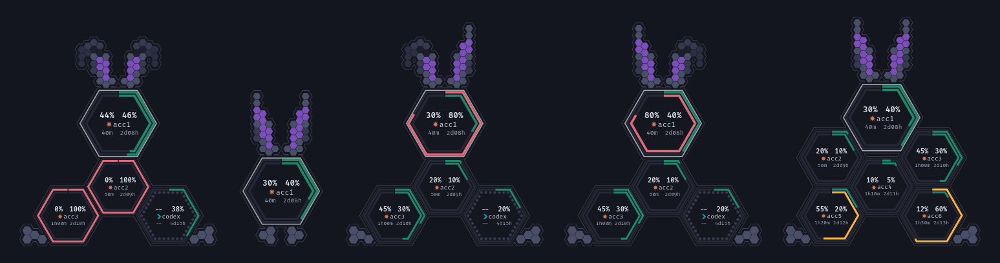

# usaKi

The usaKi app is a small floating bubble that shows how much of each AI subscription you have
used. Each account is one hex cell with a 5h ring and a 7d ring, and the cells form a rabbit. The
name comes from usagi, Japanese for rabbit. The app runs on Linux with Hyprland today. A Windows 11
build is on the roadmap, but nobody has tested it yet.



*The bubble at several account counts and fold states, with sample accounts `acc1` to `acc6` and `codex`.*

## Features

- One flat-top hex cell for each account. The head cell is the biggest and carries the ears.
  It shows the account whose 5h window resets next.
- Two rings in each cell: the 7d window outside and the 5h window inside.
- Ring colours by usage: emerald under 50%, blonde from 50%, ruby from 75%.
- In each cell: the 5h and the 7d percent, the account name with a provider mark, and both
  countdowns. The 5h values are on the left and the 7d values on the right.
- Provider marks: a terracotta starburst for Claude and a teal chevron for Codex.
- Ears that fold as a warning. The left ear folds when a 7d window reaches 75%. The right ear
  folds when a 5h window reaches 75%. Both ears fold when a window reaches 100%, or when every
  account is stale.
- A glass backplate that joins the cells, the ears and the foot pads into one silhouette.
- A card with the full detail of each account. It shows a bar and the clock time of each reset.
  It adds a moon phase for each 7d reset and the Codex credits balance.
- A saved window position and screen. On Hyprland the bubble stays on its own screen when you
  switch workspaces.

## Requirements

- Linux with Hyprland. The project tests on Hyprland 0.54.
- A recent stable Rust toolchain, with `cargo`.
- [bun](https://bun.sh) for the frontend packages and scripts.
- WebKitGTK 4.1 and the other [Tauri v2 Linux prerequisites](https://v2.tauri.app/start/prerequisites/#linux).
  On Arch Linux:

  ```sh
  sudo pacman -S --needed webkit2gtk-4.1 base-devel
  ```

The app does not need `gtk-layer-shell`. The bubble is a normal window that Hyprland pins.

## Build and run

Run the bun commands in `ui/` and the cargo commands at the repo root.

```sh
cd ui
bun install
```

| Task | Command |
|---|---|
| Run the app with hot reload | `bun run tauri dev` |
| Build a debug binary | `bun run tauri build --no-bundle --debug` |
| Build a release binary | `bun run tauri build --no-bundle` |
| Frontend tests (vitest) | `bun run test` |
| Rust tests | `cargo test --workspace` |
| Format check | `cargo fmt --all --check` |
| Lint | `cargo clippy --workspace --all-targets -- -D warnings` |

The builds write `target/debug/usaki` and `target/release/usaki` at the repo root. Use
`bun run test`, not `bun test`. The second command starts the bun test runner and not vitest.

A plain `cargo build` gives a binary that loads the Vite dev server. Use `bun run tauri build`
for a binary that holds the page.

On Linux, the app sets `WEBKIT_DISABLE_DMABUF_RENDERER=1` itself when the variable is unset.
Without it, WebKitGTK draws nothing on some NVIDIA machines. A value that you set yourself stays.

## Hyprland window rule

Add this rule to your `hyprland.conf`. It floats and pins the bubble from the moment it maps.
The pin keeps the bubble above fullscreen windows.

```
windowrule {
  name = usaki-bubble
  match:class = ^usaki$
  float = on
  pin = on
  no_initial_focus = on
  border_size = 0
  no_shadow = on
  rounding = 0
  no_blur = on
  no_dim = on
  no_anim = on
  opacity = 1.0 override 1.0 override 1.0 override
}
```

Do not unpin the bubble by hand. Hyprland hides a window that loses its pin during a
fullscreen change. The spike report
[`docs/spikes/2026-10-23-hyprland-window.md`](docs/spikes/2026-10-23-hyprland-window.md)
explains the rule.

## Data sources

The app reads three sources. You set each one up once. An account id such as `acc1` names each
Claude account. The id may hold only `A-Z`, `a-z`, `0-9`, `_` and `-`.

### Claude statusline cache

This is the main Claude source. Your Claude Code statusline command writes one JSON file per
account:

```
${XDG_CACHE_HOME:-$HOME/.cache}/usaki/claude-<acct>.json
```

Claude Code gives the statusline command the `rate_limits` of the session on stdin. Add a
snippet to your statusline command that does these steps:

1. Choose the account id, for example the local part of the account email.
2. Read `rate_limits.five_hour` and `rate_limits.seven_day`.
3. Write `account`, `five_hour`, `seven_day` and `written_at` (epoch seconds) to a temp file.
4. Rename the temp file to the cache file, so the app never reads a half-written file.

[`docs/design/claude-cache.md`](docs/design/claude-cache.md) gives the file shape, the field
rules and the staleness rule. The app finds each cache file on its own. A file older than 15
minutes shows as stale.

### Claude watcher logins

A watcher login shows a Claude account that has no running Claude Code session. It is a normal
Claude Code login in a folder that only usaKi uses. Run this once for each account:

```sh
CLAUDE_CONFIG_DIR="$HOME/.local/share/usaki/watch/acc1" claude auth login
```

The app finds the new folder within 30 seconds. It reads the token read-only and calls the
read-only usage API at most every 5 minutes per account. When the token is about to expire, the
app asks the official `claude` binary to refresh it in that folder. A fresh statusline cache file wins over the
watcher. [`docs/design/watcher-logins.md`](docs/design/watcher-logins.md) gives the full rules.

### Codex session logs

The app reads the newest `token_count` event from the Codex session logs:

```
${CODEX_HOME:-$HOME/.codex}/sessions/**/*.jsonl
```

No setup is necessary. Use Codex as usual. The app shows the Codex home as one account with the
name `codex`, after the Claude accounts. On the Pro plan Codex reports only the 7d window. The
cell then shows an empty 5h track.
[`docs/design/codex-logs.md`](docs/design/codex-logs.md) gives the read and staleness rules.

## Controls

| Input | Action |
|---|---|
| Left-drag on the bubble or the card header | Moves the window |
| Left-click on the bubble, or Enter or Space when it has focus | Opens the card |
| Click on the rabbit mark in the card header, or Escape | Closes the card |
| Click on the refresh button in the card | Reads every account now |
| Right-click on the bubble | Pins the next account into the head. It wraps and never goes back to auto. |
| Middle-click on the bubble | Returns the head to auto |

In auto mode the head shows the live account whose 5h window resets next.

The app saves the window position and screen when a drag ends and on exit. It restores them on
the next start.

## Privacy and tokens

- The app never refreshes an OAuth token itself and never writes a credentials file. A Claude
  refresh token works only once. A refresh by the app would log out your running Claude Code
  sessions. Only the official `claude` binary refreshes a token, and only in a watcher folder.
- The app opens the credentials file of a watcher login for reading only.
- The app never reads `~/.codex/auth.json` and never calls an OpenAI endpoint. The Codex parser
  skips every log line that is not a `token_count` event, so no conversation text stays in memory.
- The only network call is the read-only Claude usage API for a watcher login.
- Each machine reads its own data. The app has no sync and no telemetry.

## Status and roadmap

The MVP is done: the Claude and Codex providers, the rabbit bubble, the card, the controls and
the saved position. These items are not built yet:

- The `config.toml` file, with hot reload and configurable thresholds
- A settings window
- A tray icon and start on login
- Onboarding for install and first run ([#14](https://github.com/Kiriketsuki/usaki/issues/14))
- A Gemini provider
- A Codex watcher through `codex app-server`
- A tested Windows 11 build

[`docs/design/plan.md`](docs/design/plan.md) holds the design and the milestones.

## Licence

MIT, as the Cargo workspace declares.
